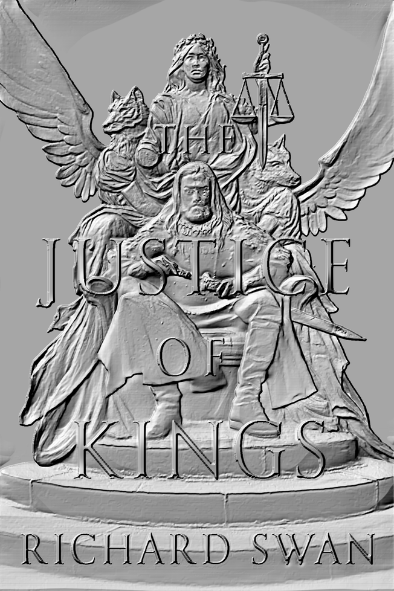

# The Justice of Kings — book cover relief

3D relief carving of the book cover. Personal, non-commercial piece: the
artwork is copyrighted, so the source image is not stored in this repo.

- **Finished size:** 6 × 9 × 1 in (152.4 × 228.6 × 25.4 mm)
- **Units:** STL is in **millimetres**
- **WCS origin:** front-left corner, **bottom** of stock (STL Z=0 is the back face)
- **Material:** to be decided (tight-grained hardwood holds the lettering best)



## Files

| File | What it is |
| --- | --- |
| `exports/justice_of_kings.stl` | Watertight relief mesh, ~698k triangles, 0.0125 in grid |
| `exports/justice_of_kings_heightmap16.png` | 16-bit heightmap (white = 1.000 in, black = 0) for other CAM tools |
| `exports/justice_of_kings_preview.png` | Shaded preview |

## Heights (all estimated from the picture)

| Feature | Height above back face |
| --- | --- |
| Flat backdrop | 0.30 in (deepest cut is 0.70 in from the top) |
| Statue / wings / wolves | ≈0.40–0.60 in |
| Seated figure | ≈0.60–0.75 in |
| Dais (foreground) | ≈0.75–0.85 in |
| Lettering | 0.08 in above the scene under it, 0.02 in drafted edges, max 0.92 in |

Thinnest letter strokes are about 0.04 in wide ("RICHARD SWAN") and 0.055 in
(title), so they need a fine-tipped bit to come out crisp.

## Regenerating / adjusting

```bash
python3 tools/relief/make_relief.py <cover image> projects/justice-of-kings-relief/exports \
  --model <depth-anything-v2-large model.onnx> --name justice_of_kings
```

Useful knobs: `--base` (backing thickness; smaller = deeper relief),
`--text-raise`, `--detail`, `--texture`, `--knee` (how much the foreground
dais is flattened), `--grid` (mesh resolution).

## Carving in Fusion (personal licence)

1. **Insert → Insert Mesh**, pick the STL, units **Millimeter**.
2. Manufacture workspace → **New Setup**: stock = fixed box 152.4 × 228.6 × 25.4 mm,
   model = the mesh body, origin as above (or top of stock if you prefer to
   zero on the surface).
3. **Roughing — 3D Adaptive Clearing**, 1/4 in flat end mill, leave 0.02 in
   radial and axial stock.
4. **Finishing — 3D Parallel**, tapered ball nose (1/32 in tip radius or
   smaller, ≥ 0.75 in reach), stepover about 0.005–0.008 in. Expect several
   hours. A second pass at 90° cleans up the lettering.
5. Post each operation as its own file with the Grbl post (no automatic tool
   change on the free licence) into `gcode/`.

Not yet verified on the machine: that the personal licence runs 3D Adaptive /
Parallel directly on a mesh body in your install. If it refuses, convert the
mesh first (Mesh → Convert Mesh) or use the heightmap in another CAM tool.

**Workholding:** a blank cut exactly 6 × 9 in leaves nothing to clamp. Use an
oversize blank and cut the outline last (with tabs), or hold it with tape and
CA glue.
